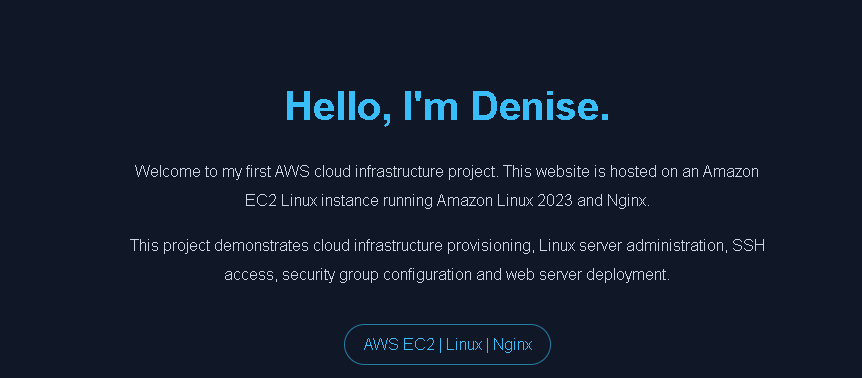
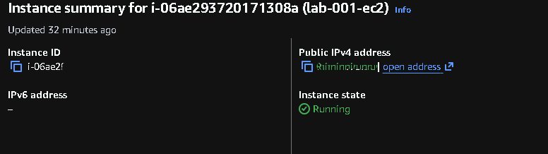
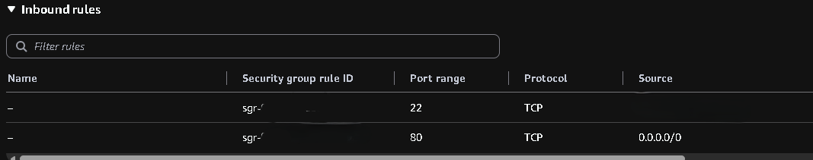
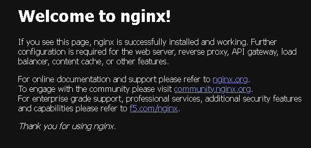

# AWS EC2 Linux Web Server Lab

Provisioned and configured an Amazon EC2 instance running Amazon Linux 2023, deployed a custom static website with Nginx, and configured CloudWatch monitoring.

**Stack:** AWS EC2 · Amazon Linux 2023 · Security Groups · CloudWatch · SSH · Nginx · HTML



## Architecture

```text
              Internet
                  |
          EC2 Security Group
          |               |
       HTTP :80        SSH :22
       Public          My IP only
          |               |
          +------- EC2 ---+
                  |
          Amazon Linux 2023
                  |
             Nginx Server
                  |
           Custom HTML Site

       CloudWatch monitors CPU
```

## Engineering work

- **Compute:** Launched a `t3.micro` EC2 instance running Amazon Linux 2023.
- **Networking:** Configured public HTTP access and restricted SSH access to my public IP address.
- **Linux administration:** Connected using SSH key-based authentication, installed Nginx with `dnf`, and managed the service with `systemctl`.
- **Web deployment:** Replaced the default Nginx page with a custom HTML website and verified public access.
- **Monitoring:** Created a CloudWatch alarm for sustained high CPU utilisation.

## Implementation evidence

**EC2 instance**



**Security group configuration**



**Nginx service**



**CloudWatch alarm**


## Security configuration

| Port | Protocol | Source | Purpose |
|---|---|---|---|
| 22 | SSH | My public IP (/32) | Remote administration |
| 80 | HTTP | 0.0.0.0/0 | Public website access |

SSH access is restricted to the configured source IP. HTTP is publicly accessible so visitors can reach the website. Private keys and AWS credentials are excluded from the repository.

## Monitoring

Configured the `lab-001-high-cpu-alarm` CloudWatch alarm:

- Metric: `CPUUtilization`
- Threshold: Greater than 80%
- Period: 5 minutes
- Evaluation: 2 out of 2 datapoints
- Notifications: Not configured

## Troubleshooting

- **Website connection timeout:** Checked Nginx status, verified port 80 was listening, reviewed security-group rules and tested connectivity using PowerShell `Test-NetConnection`.
- **SSH key permissions:** Corrected Windows private-key permissions using `icacls`.

## Future improvements

HTTPS/TLS, SNS email notifications, CloudWatch Agent memory and disk metrics, and Terraform-based infrastructure provisioning.

---

**Focus:** Cloud infrastructure · Linux administration · Networking · Web deployment · Monitoring
